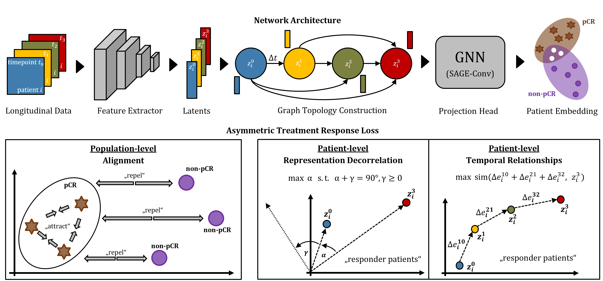

# Graph Representation Learning of Longitudinal Medical Imaging Trajectories for Treatment Response Prediction

**Johannes Kiechle1,2,3,6**, Richard Osuala2,4, Daniel M. Lang3, Stefan M. Fischer1,2,3,7, Ivana Janíčková5, Karim Lekadir4, Julia A. Schnabel1,3,6,7,\* and Jan C. Peeken2,\*

1 Technical University of Munich, Germany |
2 TUM Klinikum Rechts der Isar, Munich, Germany |
3 Helmholtz Munich, Germany |
4 Universitat de Barcelona |
5 Medical University of Vienna |
6 King's College London, United Kingdom |
7 Munich Center for Machine Learning |
\* Shared Senior Authorship 

Accepted at [MICCAI 2026 - Workshop on GRaphs in biomedicAl Image anaLysis (GRAIL)](https://grail-miccai.github.io/)

  

**Abstract:** In patients with breast cancer, pathological complete response (pCR) has been established as a clinically meaningful surrogate marker for long-term outcomes. While commonly treated with neoadjuvant chemotherapy (NACT), effective treatment decision-making remains challenging, as therapeutic response can vary substantially across patients, calling for predictive models capable of accurately estimating individualized treatment response. To address this, we propose an imaging-based 3D spatio-temporal framework for treatment response prediction that integrates a state-of-the-art graph neural network with relational modeling of temporal interactions across timepoints alongside three novel complementary self-supervised treatment trajectory representation learning objectives. 

Experiments across a cohort of 585 patients from the public ISPY-2 dataset demonstrate that our method substantially outperforms both vision and self-supervised learning baselines across several classification metrics. Alongside establishing a breast cancer pCR prediction benchmark, we include a principled ablation of our method and further introduce and empirically assess the impact of the available number of DCE-MRI timepoints per patient trajectory and the inclusion of inter-scan time-differences. Overall, our study substantiates the utility of clinically meaningful longitudinal medical imagaging modeling for predicting NACT-induced pCR.

**Keywords:** GNNs · Longitudinal · Self-Supervised · Breast Cancer

Source Code will be released upon publiction.